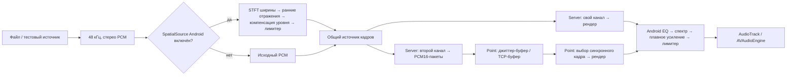

# Аудиоалгоритмы SoundField: устройство, формулы и фактический статус

**Аудит исходного кода:** 2026-10-07
**Снимок версий:** Android `1.10.12` (`versionCode 50`), пространственный DSP `1.9.2`, iOS `1.2.5` (`CURRENT_PROJECT_VERSION 15`).
**Пересмотр:** 2026-10-07 — Solo стал независимым локальным плеером; короткое нажатие `Connect` восстанавливает последнюю пару, а удержание или свайп вниз открывает выбор телефонов. В Solo на экране остаются круги L/R с подписью `MyPhone`.
**Область:** алгоритмы и потоки данных, которые можно проследить от текущего рабочего дерева приложения. Это описание исходников на дату аудита, а не план из ТЗ.

> **Короткий итог по платформам.** Общие для Android/iOS части — модель 48 кГц, сетевое воспроизведение пары, баланс/громкость, калибровка задержки, генерация измерительных сигналов и спектральная оценка уровня. В Android дополнительно есть плеер на главной странице (соло без пары, переходящий в пару и обратно без остановки музыки), 32-отводный дробный ресемплер воспроизведения, графический EQ с анализатором и пространственная DSP-цепочка. В текущем iOS-коде EQ, пространственная обработка и соло-плеер не реализованы; декодирование и вывод там делегированы AVFoundation.

## 1. Что именно описано

В документ включены алгоритмы, участвующие в приложении или его штатных аудиодиагностиках: загрузка/приведение PCM, выбор кадров для вывода, синхронизация двух часов, применение усиления, EQ, пространственная обработка, передача и восстановление аудиокадров, калибровка и тестовые сигналы.

Прототипы в `tools/spatial-proto/` не являются частью аудиотракта приложения и здесь не выдаются за работающий DSP. `android/.../tools/SpatialRenderMain.kt` — офлайн-оболочка над production-классом `SpatialSource`, а не отдельный алгоритм воспроизведения. Само формирование вывода Android выполняет `AudioTrack`/планировщик, iOS — `AVAudioEngine`/Core Audio; скрытую обработку прошивки динамика, Android AudioFlinger, драйвера, Bluetooth-кодека и системных эффектов исходники приложения не определяют.

### 1.1 Основные термины

- **Кадр (frame)** — один отсчёт на каждый канал в общей сетке 48 000 кадров/с. Например, 480 кадров — 10 мс.
- **Server** — телефон-источник общей временной шкалы. В паре он локально воспроизводит назначенный ему канал и отправляет второй канал Point.
- **Point** — второй телефон. Он получает моно PCM-кадры и воспроизводит их в назначенный момент по часам Server.
- **Эпоха (`epoch`)** — идентификатор непрерывного участка временной шкалы. Play, seek, смена трека и некоторые переходы начинают новую эпоху; кадры старых эпох отбрасываются.
- **dBFS** — цифровой уровень относительно полной шкалы Float PCM; амплитуда 1 соответствует 0 dBFS.
- **Production** — подключённый к приложению путь. «Есть реализация» ниже не всегда означает «активна на всех устройствах».

### 1.2 Карта аудиотрактов

### 1.3 Состояния приложения: соло и пара (Android)

Приложение открывается в **соло**: `Engine` сразу запускает локальное воспроизведение (`startSoloPlayback`), фаза остаётся `IDLE`, роль — Server без Point. Соло играет **стерео** (`AudioTrack` на два канала, `Ch.BOTH`, рендер `ServerRenderer.renderStereo`); в паре обычный вывод — **моно своего канала**. Долгое нажатие на `Server` или `Point` отключает пару и открывает локальный стереоплеер с собственными файлами. Повторное удержание `Solo` восстанавливает сохранённую пару и роль; при неудаче локальный плеер продолжает работать. Громкость соло хранится отдельно от парной (`soloMaster`), EQ и spatial — по ключу аудиомаршрута.

| Переход | Что происходит со звуком |
|---|---|
| соло → Server (пригласили или восстановили роль Server) | Музыка не сбрасывается: позиция и состояние «играет/пауза» берутся из соло (`soloHandoffFrame`) и становятся новой эпохой Server. Меняется только вывод: стерео → моно своего канала (AudioTrack переоткрывается: короткий разрыв, его длительность на устройстве не измерялась) |
| соло → Point (приняли приглашение) | Локальная музыка ставится на паузу; очередь и позиция остаются в памяти (`soloResumeFrame`) |
| пара → соло (разрыв) | Бывший Server продолжает ту же музыку в стерео с той же позиции; бывший Point возвращается к своей очереди на паузе |
| фоновое восстановление пары при играющем соло, сохранённая роль Point | Откладывается (`AUTO_RESUME_DEFERRED`), входящий resume получает `busy`, чтобы не оборвать музыку; роль Server восстанавливается как обычно |

Foreground-сервис соло запускается, когда музыка начала играть, и останавливается через 5 минут паузы; без него приложение в фоне снимает публикацию и поиск. Калибровка требует пары и в соло не показывается.

SpatialSource находится **до** разделения пары на Server/Point: если пространственная функция доступна и включена, обработанный стереоисточник используется и для локального канала Server, и для канала, отправляемого Point. EQ применяется **локально после разделения** — отдельно на каждом Android-выходе. Поэтому выходной анализатор EQ показывает сигнал данного телефона, а не измерение акустического звука комнаты.

## 2. Файл, декодирование и формат PCM

### 2.1 Общий внутренний формат

Музыкальный источник приложение читает по абсолютному номеру кадра. Движок получает стерео `L/R`, Float PCM при рендере и общую частоту 48 кГц. На сетевой стереопаре каждый канал передаётся отдельно как моно PCM 24 бит (протокол v3, с A1).

### 2.2 Android: импорт и потоковое декодирование

`AudioFileDecoder` выбирает первую аудиодорожку через `MediaExtractor`, передаёт сжатые пакеты в `MediaCodec` и читает результат в одном из поддержанных PCM-форматов: 8/16/24 packed/32 bit или Float. Если дорожка моно, её отсчёт копируется в L и R. Если каналов два и больше, берутся первые два, остальные пропускаются; downmix многоканального surround в стерео не рассчитывается.

Декодер выдаёт стерео 48 кГц PCM 24 бит little-endian (сегменты `*.pcm24`, метка завершения `v3 <кадры>`; кэш PCM16 версий до A1 распознаётся и перекодируется). Квантование float → 24 бит — TPDF-дизеринг ядра (§13.7). Данные пишутся на диск сегментами по 5 секунд и публикуются по мере готовности. Источник не заставляет аудиопоток ждать декодер: ещё не готовый кадр обозначается как отсутствующий; на рендере он становится тишиной и учитывается как пропуск. При повторном чтении готового кэша сегменты отображаются в память (`mmap`), поэтому весь длинный трек не хранится в Java heap.

Если вход уже 48 кГц, ресемплера нет. Иначе (A1.2) используется `SampleRateConverter` поверх ресемплера ядра (§13.7); описанный ниже `StreamResampler` остаётся только запасным путём без `libsfdsp`:

1. Сокращаются входная и выходная частоты на `gcd(inRate, outRate)`. Для 44,1 → 48 кГц получаются 147 входных шагов на 160 фаз выхода.
2. Для каждой дробной фазы заранее строится 24-отводный оконный sinc: идеальная sinc-функция ограничивается окном Блэкмана. Частота среза — `0,94 × min(1, outRate / inRate)`, чтобы подавить зеркальные компоненты при понижении частоты.
3. Коэффициенты каждой фазы нормируются так, чтобы сумма была 1 (постоянный сигнал не меняет уровень).
4. Входные блоки можно подавать любой длины; кольцевой буфер удерживает отсчёты, нужные будущим фазам. На EOF хвост досчитывается, считая сигнал за границей файла нулевым.

Это **ресемплер при подготовке импортированного файла**, не тот же самый фильтр, что выбирает дробную позицию чтения во время синхронизации пары (см. §4.3).

### 2.3 iOS: импорт и декодирование

iOS копирует импортированный файл в `Application Support`, декодирует его целиком через `AVAudioFile`, читает его блоками в float32 (`processingFormat`), ресемплирует ядром (`SfSampleRateConverter`) и кодирует в 24 бит с TPDF. Декодированный PCM (24 бит, 6 байт на кадр) хранится целым массивом в памяти. Int16 и `AVAudioConverter` не используются (A1).

### 2.4 Тестовый WAV-путь

Небольшой встроенный `test_track.wav` читается собственным WAV-парсером. Он принимает RIFF/WAVE PCM 8/16/24/32 бит и float32, mono/stereo; mono дублируется на два канала. Если sample rate не 48 кГц, применяется тот же ресемплер ядра (с A1; раньше — линейная интерполяция).

## 3. Сетевой медиатракт стереопары

### 3.1 Разделение каналов и пакет

Server хранит стереоисточник и задаёт, какой канал играет сам. В UDP-пакет попадает противоположный канал (`other(serverChannel)`), начиная с абсолютного `startFrame`. Пакет содержит эпоху, sequence number, кадр начала, плановое время воспроизведения, время отправки, число кадров, флаг повтора и массив PCM16. Номинальный пакет — 384 кадра/8 мс, PCM 24 бит (с A1); если непрерывная готовая часть источника заканчивается внутри пакета, отправляется короткий пакет и курсор сдвигается на фактически отправленное число кадров. Передача ведётся примерно на 400 мс впереди общего playhead.

Пакетная ветка берёт кадры из `ServerPlayState.source`, поэтому в неё попадают уже применённые к стереоисточнику spatial DSP, если он был включён. Пользовательские Master/Balance/trim и локальный выходной EQ не кодируются в аудиопакет; Point получает эти параметры отдельно через состояние пары и применяет свой gain/EQ при локальном рендере.

### 3.2 UDP, буфер и восстановление потерь

Point записывает кадры в кольцо на 131 072 отсчёта (около 2,73 с при 48 кГц). Каждая ячейка имеет абсолютную метку кадра: совпадение метки позволяет безопасно читать без блокировки аудиопотока; чужой/перезаписанный кадр считается отсутствующим.

Дополнительно ведутся sequence numbers:

- пропущенные номера помещаются в список ожидающих восстановления;
- начиная через 12 мс Point отправляет NACK; запросы повторяются с интервалом не менее 40 мс, максимум четыре раза;
- после 350 мс невосстановленная потеря становится окончательной;
- Server держит кольцевой индекс последних 1024 отправленных пакетов и повторно отправляет их по NACK, если совпадают эпоха и номер;
- слишком большой sequence gap (более 256 пакетов) не заполняется тысячами запросов.

Кадр, пришедший после того, как его временной диапазон уже проигран, помечается опоздавшим и не может исправить звук задним числом. Если нужных отсчётов нет, Point формирует тишину. В Android дробный sinc-рендер требует все 32 соседних отсчёта: отсутствие даже одного tap делает конкретный интерполированный отсчёт отсутствующим.

### 3.3 Альтернативная TCP-доставка

Для TCP-аудио есть отдельный бинарный формат: моно PCM 24 бит/48 кГц (magic `SFA2`), чанки до 4800 кадров (100 мс). Получатель располагает активным и подготовительным кольцами с абсолютными тегами, чтобы загрузить новую эпоху/seek, пока старая ещё звучит. Перед переключением проверяется непрерывный набор кадров от нужной позиции. Это транспортный буфер; правила общего времени и рендер Point остаются теми же. В протоколе UDP-версии 1 этот путь не меняет PCM-пакет.

## 4. Общая временная шкала и выбор кадра

### 4.1 Timeline, старт и пауза

Для Server время кадра задаётся линейно:

`time(F) = anchorNs + (F − anchorFrame) / 48000`.

Play/seek обычно назначают старт через 300 мс, чтобы успеть передать Point новое состояние и начальные аудиопакеты. Пауза Android может быть запланирована на конкретный `stopFrame` через 150 мс; обе стороны доходят до одной границы, хотя команда идёт по сети. Android Timeline формирует 5-мс fade-in после якоря и 5-мс fade-out перед запланированной паузой. Изменения эпохи инвалидируют старые кадры.

iOS реализует ту же формулу якоря и эпоху, но его текущий `Timeline` не содержит Android-полей `stopFrame`/frame envelope. На iOS рендер не использует эту пару коротких временных огибающих; от щелчка при изменении общего gain защищает `GainRamp`.

На обеих платформах renderer Server и Point при переходе в паузу без запланированного `stopFrame` (прерывание, смена эпохи) затухает за 5 мс от последнего выведенного отсчёта (`PauseFade`) вместо обрыва в ноль.

### 4.2 Синхронизация монотонных часов

Server — эталонные часы, Point оценивает преобразование локального времени в Server time. Для четырёх временных меток PING/PONG:

- `fwd = t2 − t1` — Point → Server;
- `bwd = t4 − t3` — Server → Point;
- предполагая, что очередь только увеличивает задержку, минимумы направлений приближают физические минимальные задержки;
- `offset ≈ (min(fwd) − min(bwd)) / 2`.

В Android дополнительно используется односторонняя оценка Server → Point из времени отправки каждого аудиопакета. Минимумы хранятся в двухсекундных корзинах (не более 40 корзин, примерно 80 с). Корзина пригодна при наличии минимум трёх наблюдений в каждом направлении. Сначала берётся смещение лучшей из последних корзин; когда накопилось не менее пяти пригодных корзин за 12 с, строится взвешенная линейная регрессия `offset(t)=a+b(t−ref)`. `b` — дрейф часов; значения ограничиваются диапазоном ±300 ppm (раньше обнулялись). Заявленная погрешность модели не меньше половины минимального RTT — это предел ошибки метода симметричной задержки при асимметрии Wi-Fi. Пока регрессии нет, опорная корзина меняется только если новая лучше текущей не менее чем на 20% (гистерезис). Вес корзины обратно пропорционален квадрату оценки её RTT/качества.

Android сглаживает обновление модели: кроме первого замера, первых 12 секунд соединения и скачка модели свыше 2 мс, разницу старой/новой модели постепенно вводит максимум со скоростью 2 мкс на секунду. iOS использует ту же оценку минимумов и регрессию (без Android-варианта односторонних packet samples и без этого дополнительного корректора модели). В обоих случаях по каждой точке буфера renderer отдельно оценивает jitter/ошибки.

### 4.3 Аппаратный момент вывода

На Android аудиовыход запрашивает timestamp у `AudioTrack`. Если timestamp свежий и согласован с числом реально записанных кадров, время вывода первого кадра блока вычисляется из `timestampNs + queuedFrames / 48000`. При невалидном/устаревшем timestamp используется playback head, ограниченный размером буфера, и небольшой запас 20 мс. Запись — Float PCM, блок по 240 кадров (5 мс), `AudioTrack` в streaming/low-latency режиме.

iOS передаёт renderer host time AVAudioSourceNode плюс `AVAudioSession.outputLatency`. Если host time отсутствует, используется текущее monotonic time с оценкой output latency и дополнительными 5 мс. Узел просит у renderer моно Float PCM/48 кГц. Физическая и часть системной задержки всё равно зависит от маршрута и телефона; акустическая калибровка компенсирует остаточную разницу пары.

### 4.4 Подстройка скорости чтения

Даже после перевода часов часы и аппаратные аудиотакты могут понемногу расходиться. `PlayoutCorrector` сравнивает идеальный дробный номер кадра с текущей позицией чтения.

**Android:** фильтрует ошибку первого порядка (`filt += 0,1 × (err−filt)`), интегрирует ошибку времени в пределах ±50 мс и применяет PI-поправку с коэффициентами `Kp=2/3 с⁻¹`, `Ki=1/9 с⁻²`. Отношение скорости чтения ограничено ±200 ppm. Ошибка больше 960 кадров (20 мс) вызывает жёсткую переустановку позиции и сброс PI-состояния.

Дробная позиция обслуживается отдельным 32-tap sinc-фильтром Kaiser (`β=8,6`) с таблицей 256 фаз. Коэффициенты нормированы. На каждую выходную позицию выбираются 32 отсчёта вокруг дробного индекса; выбор ближайшей фазовой таблицы устраняет щелчки от пропуска/дублирования целого сэмпла. Renderer компенсирует постоянный групповой сдвиг в 16 кадров.

**iOS:** в портированном renderer позиция чтения целочисленная. При фильтрованной ошибке больше 6 кадров (0,125 мс) на блок в 240 кадров выполняется подстройка на один кадр: одна половина блока берёт позицию с пропуском либо повтором одного отсчёта, а счётчик позиции меняется на `n±1`. При ошибке более 20 мс происходит hard resync. В iOS-коде отдельного 32-tap fractional sinc нет.

### 4.5 Плавное изменение gain

`GainRamp` на обеих платформах — однополюсное экспоненциальное приближение текущего коэффициента к целевому с постоянной времени 15 мс:

`g[n] = g[n−1] + k × (target − g[n−1])`, `k=1−exp(−1/(0,015×48000))`.

Каждый отсчёт умножается на текущий `g`. Это сглаживает команды громкости, баланс и калибровочный trim, не вводя ступеньки между блоками.

## 5. Громкость, баланс и калибровочный trim

Общие формулы находятся в `AudioGain` и совпадают на Android/iOS.

### 5.1 Master

Пользовательское значение `v` ограничивается диапазоном [0,1]. Оно переводится в линейный gain по линейной шкале децибел от −50 до 0 dB:

`gain = 10^[−50×(1−v)/20]`.

Ниже `v=0,005` выход выключается в ноль. На v=1 gain=1 (0 dB), на v=0.5 приблизительно −25 dB. Исторические настройки мигрируются из старого линейного gain обратным преобразованием.

**Положение ползунка (Android, 1.9.2).** `v` (`master`) хранится и передаётся по сети по этому закону, но положение ползунка `u∈[0,1]` теперь сопоставляется с ним по воспринимаемой громкости: `gain = u^1,4` (≈28 dB на декаду), то есть `v = 1 + 20·log10(u^1,4)/50` (нижняя граница `v=0,005`, ниже `u=0,005` — ноль) и обратно `u = gain^(1/1,4)`. Раньше `u=v`: 50 dB шли равномерно, и нижняя треть шкалы лежала ниже −35 dB, где изменения не слышны. Теперь `u=0,1` ≈ −28 dB, `0,3` ≈ −15 dB, `0,5` ≈ −8 dB, `0,85` ≈ −2 dB (значение по умолчанию 0,96 в `v` показывается как 85 %). Равные шаги ползунка дают близкие шаги воспринимаемой громкости (Стивенс: громкость ∝ амплитуда^0,6, отношение наибольшего к наименьшему шагу по десяти шагам < 2). Формат `master`, миграция и сетевой протокол не менялись, поэтому совместимость с iOS и прошлыми версиями сохранена. **На iOS ползунок остаётся линейным по `master`** (то есть по dB). Порог измерения уровня по микрофону — по-прежнему `v≥0,5` (−25 dB), в сообщении он выражен в новых процентах ползунка.

### 5.2 Баланс каналов

Для положения `b∈[0,1]` вычисляется `p=2b−1`. Канал в сторону которого уведён баланс остаётся на unity; второй получает квадратичное ослабление:

`gain_quieter = (1−|p|)²`.

В центре оба канала остаются на 0 dB; на краях один канал полностью заглушён. Квадрат даёт −12 dB ослабления при перемещении на четверть шкалы от центра. Баланс применяется только к музыкальному источнику, не к служебным тестовым режимам.

### 5.3 Уровневые trims устройств

Отдельный trim Server и Point ограничен от −12 до 0 dB и преобразуется как `10^(dB/20)`. Оба телефона получают один Master, но свои trims. Старые парные линейные gain мигрируются в dB так, чтобы более громкое из двух устройств стало 0 dB, а второе выражало только относительную разницу. Общий gain каждого телефона умножается на Master, trim своего устройства и, для музыки, gain своего канала баланса.

## 6. Графический эквалайзер Android

EQ реализован в `core/Equalizer.kt`, применяется в `ServerRenderer`/`PointRenderer` после выбора исходных кадров и до ramp/выходного ограничителя. Одинаковые аудиопараметры — enable, gains, magnet, preset, preserveLoudness и bypass — передаются Point по управляющему состоянию пары при согласованной возможности `eq`; DSP каждого телефона выполняет фильтрацию локально. Флажок показа анализатора `analyzerEnabled` остаётся локальной настройкой UI и по сети не передаётся. В solo настройки EQ сохраняются отдельно по ключу маршрута вывода; для Bluetooth маршрутный ключ использует адрес, если он доступен. Кнопка сворачивания карточки Sound хранит `eqExpanded` в Android preferences — состояние UI отдельно от звуковых параметров.

В iOS EQ-процессора и EQ-экрана в текущей реализации нет.

### 6.1 Частоты, параметры и пресеты

Десять октавных центров: **31,5; 63; 125; 250; 500; 1000; 2000; 4000; 8000; 16000 Гц**. Значения каждой полосы приводятся к диапазону от −12 до +12 dB с шагом 0,5 dB.

Встроенная таблица пресетов (`EqPresets`) — единственный кодовый источник:

| Пресет | Усиления полос от 31,5 Гц до 16 кГц, dB |
|---|---|
| Ровно | 0, 0, 0, 0, 0, 0, 0, 0, 0, 0 |
| Больше баса | +4, +3,5, +2,5, +1,5, 0, 0, 0, +0,5, +1, +1 |
| Вокал | −2, −1,5, 0, +1, +2,5, +3, +2, +0,5, 0, −0,5 |
| Яркость | −1,5, −1, 0, +0,5, 0, +0,5, +2, +3, +3,5, +2,5 |
| Мягко | +1, +1, +0,5, 0, −0,5, −1, −1, −0,5, +0,5, +1 |
| Динамик телефона | −12, −9, −5, −2, 0, +1,5, +2, +1,5, +0,5, 0 |

Пользовательские пресеты хранят 10 значений gain и имя. Сам EQ-профиль пары хранится у Server в записи пары; отдельный solo профиль сохраняется локально для каждого аудиомаршрута.

### 6.2 Магнитное движение и прямая настройка

При перетаскивании полосы вычисляется расстояние до соседей в октавах `d=|log₂(fj/fi)|`. Соседняя полоса следует за основной с гауссовым весом:

`w = exp(−ln(2) × (d/σ)²)`.

У `SOFT` σ=0,8 октавы, у `STRONG` σ=1,4; `OFF` устанавливает вес 0. При d=σ сосед проходит половину основного изменения. Веса меньше 0,05 игнорируются. Ограничитель не позволяет соседям пересечь перетаскиваемую полосу в сторону от нуля. При долгом нажатии интерфейс временно переходит на точную настройку без магнита; рисование по графику также использует этот закон движения. Значения и жесты ограничены ±12 dB. Для маршрута встроенного динамика UI ограничивает первые две полосы сверху +3 dB.

### 6.3 Синтез полос и «точная каскадная» АЧХ

Каждая полоса — peaking biquad с постоянным `Q=√2`. Для желаемого gain `G`:

- `A = 10^(G/40)`;
- `ω0 = 2π f0 / 48000`;
- `α = sin(ω0)/(2Q)`;
- коэффициенты RBJ peaking EQ: `b0=1+αA`, `b1=−2cos(ω0)`, `b2=1−αA`, `a0=1+α/A`, `a1=−2cos(ω0)`, `a2=1−α/A`; все коэффициенты нормируются на `a0`.

Обычная каскадная сумма этих десяти фильтров может не попасть точно в значения, заданные на частотах полос. Здесь отдельный этап настройки рассчитывает внутренние gains фильтров. Он семью итерациями Ньютона вычисляет частотный отклик каскада в десяти центрах, оценивает матрицу Якоби конечной разностью ±0,05 dB и решает систему 10×10 с выбором главного pivot. Внутренние gains корректируются так, чтобы общая АЧХ на центрах совпала с целевой; решатель останавливается раньше, если ошибка стала меньше 0,015 dB. Это цель итерационного расчёта, а не гарантия для каждой комбинации: всего выполняется до семи итераций, внутренние gains ограничиваются ±36 dB, а при вырожденной системе остаётся последнее найденное решение. Gain отдельного biquad может выходить за пользовательский диапазон ±12 dB — это нужно, чтобы компенсировать перекрытие соседних фильтров.

График строится не соединением ползунков, а расчётом амплитудного отклика этих же biquad-фильтров на логарифмической сетке. Поэтому отображается расчётная АЧХ реализуемого каскада.

### 6.4 Предусиление, запас до перегрузки и равная громкость

Из 512 точек АЧХ на логарифмической сетке 20 Гц–20 кГц берётся максимальный подъём `peak`. Если EQ включён, автозапас (preamp) равен `−max(0, peak)`: общая кривая не должна математически превышать 0 dB. Это **запас по расчётной АЧХ**, а не гарантия отсутствия межсэмпловых истинных пиков.

При `preserveLoudness` средний уровень кривой оценивается на розовом спектре (равная плотность в логарифме частоты) с K-weighting коэффициентами, используемыми BS.1770. При обработке с ослаблением можно вернуть часть потерянной средней громкости. Возврат не может выйти за уже рассчитанный запас `−peak`; подъёмы EQ не компенсируются обратно до клиппинга. Получившийся `outputGain` задаёт предварительное общее усиление фильтрованного сигнала.

«Без эквалайзера» — не выключение процесса и не bypass лимитера. При включённом EQ этот режим переключает 30-мс кроссфейд между фильтрованной веткой и сухим сигналом. Для сухой ветки рассчитывается компенсация по средней K-взвешенной громкости, чтобы сравнение было ближе по воспринимаемому уровню. Переключение режима само сглаживается вместе с параметрами.

### 6.5 Применение в аудиопотоке и постоянный лимитер

Тяжёлый расчёт кривой, Newton-решение системы и новых `EqConfig` делается вне аудиоколбэка. Renderer атомарно подхватывает неизменяемую конфигурацию. При новом значении цель каждого фильтра, preamp и bypass-mix за 1440 кадров (30 мс) приближается к цели; коэффициенты biquad пересчитываются группами не чаще 32 кадров. Состояние `x1,x2,y1,y2` у каждой из десяти полос остаётся непрерывным.

**С A1 (Android 1.10.32) описанный ниже sample-peak limiter заменён** финальным true-peak лимитером ядра −1,0 dBTP (§13.7): после GainRamp стоит `PeakLimiter` (упреждение 1,5 мс + 16 кадров детектора = 87 кадров), его задержка вычитается корректором из позиции чтения. Дальнейший абзац описывает поведение до A1.

Это sample-peak ограничитель: в 49-точечном окне задержки ищется наибольшая абсолютная амплитуда, атака gain вниз мгновенная, возврат к unity экспоненциальный с константой 50 мс. Отсчёт задерживается на 48 кадров, а gain умножает его и зажимает результат в [−1,1]. В стереорендере у левого и правого каналов свои экземпляры и свои peak/gain состояния. Он **не делает oversampling**, поэтому не является true-peak лимитером и не оценивает межсэмпловый пик.

iOS не выполняет EQ и в своём рендере не добавляет этот 1-мс limiter.

### 6.6 Анализатор спектра EQ

Android пишет в кольцевой буфер до 8192 Float-отсчётов (около 171 мс), однако для одного измерения берёт последние 4096 (85,3 мс). Сигнал проходит Hann window и 4096-точечный radix-2 FFT; энергия объединяется в 60 логарифмических полос между 20 Гц и 20 кГц, после чего преобразуется в dB. Анализатор захватывает выход после EQ-tone, но **до пользовательского gain и limiter**; в stereo-соло анализируется среднее `(L+R)/2`. UI запрашивает спектр примерно каждые 33 мс и визуально сглаживает падение столбиков.

FFT здесь — отображающий анализатор, не график АЧХ EQ: кривая АЧХ вычисляется аналитически из biquad, анализатор — по текущей музыке.

## 7. Spatial DSP Android

### 7.1 Когда SpatialSource создаётся

В runtime SpatialSource подключается только к музыкальному источнику при включённых настройках, доступной функции и отсутствии временного bypass. Для пары требуются согласованная capability `spatialV1` и встроенный динамик. Для соло требуются встроенный стереодинамик и горизонтальная ориентация. Неизвестная модель может пройти проверку стерео через Android `AudioManager`; параметры XTC при этом всё равно не считаются проверенными автоматически.

В составе пары spatial Source запускается на Server **до** отправки каналов; Point принимает уже подготовленный противоположный канал. Каждый выходной телефон применяет свой EQ и свою конечную громкость локально. Уровни профиля умножаются на strength `0,6` для Soft и `1,4` для Strong. Пользовательские значения после sanitization ограничены так: mid/high 0…+8 dB, ambient 0…+6 dB, depth −6…0 dB, reflection −30…−10 dB.

| Профиль из `spatial_profiles.json` (v3) | `span` — масштаб выноса за базу | XTC beta |
|---|---|---|
| Pair wide | 1,0 | — |
| Pair near | 1,25 | — |
| Solo stereo speaker | 1,5 | 0,06 (только проверенное устройство или developer override) |
| Off | 1,0 | — |

Пользователь управляет двумя ползунками 0…1: «Ширина» и «Глубина» (`SpatialSettings.width/depth`). Оба в нуле — точный обход. Поле `level` осталось для провода (iOS, версии до 1.10.36) и слепого A/B: без `width/depth` в команде берётся пара уровня (Мягко 0,4/0,3; Сильно 0,8/0,6).

SpatialSource считает звук на отдельном worker thread и публикует готовые кадры в кольцевой PCM-кэш ёмкостью по умолчанию 40 секунд. Из этого следуют буфер готовности и возможные underrun; рендер-колбэк не выполняет STFT и не ждёт пространственный worker. Если worker ещё не дошёл до запрошенного кадра, `sample()` временно возвращает «кадр отсутствует»; сам по себе такой промах не перезапускает DSP, worker продолжает штатную обработку. Restart назначается, когда кадр уже вышел за закэшированный диапазон: он старше самой ранней сохранённой позиции или лежит дальше ёмкости кэша впереди `processedHead`. При restart сбрасываются FFT overlap-add, маски/атаки, история отражений, XTC, loudness и limiter; worker начинает примерно за 1 секунду до целевого кадра, выравнивает обработку по 512-кадровому hop и прогревает фильтры. Это восстанавливает состояние анализаторов и перекрывающихся окон после seek вместо продолжения со старыми временными данными.

При смене spatial-параметров во время музыки новый SpatialSource запускается с позиции за 50 мс до точки переключения, чтобы прогреть DSP до перехода. Старый и новый источник смешиваются линейным кроссфейдом длительностью 50 мс. Это тот же класс временного переключения, который применяется при автоматическом bypass из-за нагрузки.

### 7.2 STFT/ISTFT и lookahead подготовки

Стереосигнал разбивается на кадры FFT размера 2048 (42,67 мс) с шагом 512 кадров (10,67 мс) при частоте 48 кГц. Каждое окно умножается на `sqrt(Hann)`; после обратного FFT окно применяется второй раз, и overlap-add суммируется с весами `window²`. Перед публикацией каждый отсчёт делится на накопленный вес — это восстанавливает исходный масштаб при перекрытии.

SpatialProcessor использует пять будущих hops = 2560 кадров = 53,33 мс для анализа атаки; limiter тоже требует 240 будущих кадров = 5 мс. Это lookahead и требование заранее подготовить PCM, а не сдвиг временных меток выходного кадра: SpatialSource публикует результаты в кэш под абсолютным номером исходного кадра, и общий timeline остаётся выровненным. Worker должен обрабатывать источник с достаточным опережением; нехватка готовых кадров может стать underrun и вызвать автоматический bypass.

### 7.3 Сцена: разделение на прямой и рассеянный звук (Spatial DSP 2.0.0, Android 1.10.36)

Прежняя схема (усиление Side с ограничителем `Side ≤ Mid` в каждом бине, ослабление Mid на 1–2 dB, отражения −17 dB) почти не меняла звук: у жёстко разведённого источника Side уже равен Mid, и ограничитель держал усиление на единице. Она заменена.

Для каждого бина по сглаженной ковариации L/R (`a=E|L|²`, `b=E|R|²`, `c=E[L·R*]`; по частоте ±1/12 октавы) находится главная ось `v` — направление доминирующего источника. Сигнал делится точно: прямой `P = v·(vᴴx)` и остаток `A = x − P`.

Оценка двусторонняя: половина — рекурсивное прошлое (80 мс), половина — среднее по пяти будущим кадрам из кольца lookahead. Новый источник получает верное направление с первых миллисекунд.

Доверие к оси `κ = smoothstep(ρ; 0,15; 0,5)`, `ρ = (λ1−λ2)/(λ1+λ2)`. В диффузном поле ось случайна: там перепанорамирование отключается, а «прямая» часть считается рассеянной.

### 7.4 Ширина

Угол панорамы прямого источника `ψ = atan2(|vR|, |vL|)`, отклонение от центра `δ = ψ − π/4` растягивается: `δσ = δ·σ`, `σ = 1 + width·F(f)` (до 2×).

- Внутри базы (`|δσ| ≤ π/4`) отображение линейное: частично разведённые источники уходят к краям.
- За краем противоположный канал получает тот же сигнал в противофазе, и образ выходит **за пределы колонок**: `|δ′| = π/4 + Ω·(1 − exp(−e/Ω))`, `e = |δσ| − π/4`, `Ω = min(0,6; width·span·Ωmax(f))` рад. `Ωmax` = 0,38 в полосе 250 Гц–1,2 кГц и плавно падает до 0,15 к 5 кГц: на ВЧ противофаза даёт только «фазовость».
- Мощность источника сохраняется (`cos²+sin²=1`). Центр (`δ=0`) не затрагивается математически.
- Ниже 120 Гц обработки нет, переход до 250 Гц.

Правка вносится как разность `Δ` к исходному спектру, поэтому при нулевом сдвиге выход равен входу точно.

Рассеянная часть поднимается: её Side — на `4,5·width` dB, вся — на `2·depth` dB. На атаках (детектор спектрального потока, порог `max(0,25; медиана + 4·MAD)`) подъём снимается, чтобы транзиенты не размазывались в стороны.

### 7.5 Глубина

В частотной области формируется посыл в помещение: `Send = W(f)·(0,5·прямой + 1,0·рассеянный)`. Рассеянный звук идёт в помещение на 6 dB горячее, поэтому дальние планы уходят назад, а сухие передние остаются впереди. `W(f)`: ноль ниже 150 Гц, единица с 350 Гц до 6 кГц, 0,5 выше 12 кГц.

`SceneRoom` (временная область):

- ранние отражения: по 11 отводов на выход, 6–45 мс, свои и перекрёстные, таблицы L и R разнесены ≥ 0,77 мс;
- поздняя часть: FDN из 8 линий (23–52 мс, взаимно простые длины), матрица Хаусхолдера, `RT60 = 0,25 + 0,40·depth` с, затухание ВЧ вдвое быстрее; выходы L/R берутся с ортогональными знаками;
- уровень: амплитуда ∝ `depth^1,2`.

### 7.6 Измеренное поведение (JVM, `SpatialSceneTest`; не акустика)

| Что | Результат |
|---|---|
| Центр (L=R), ширина 1 | L−R = 0, уровень не меняется |
| Жёстко левый шум, ширина 1 / 0,5 | в R противофаза −9,3 / −15,5 dB от L (корреляция −1,00 в 300–1200 Гц), мощность 0,00 dB |
| Источник с ILD 6 dB, ширина 1 | ILD 16,9 dB |
| Некоррелированные L/R, ширина 0 / 0,5 / 1 | Side/Mid 0,0 / 2,2 / 4,4 dB; мощность до +2,7 dB |
| Тоны 60 и 100 Гц, оба ползунка 1 | изменение −77,6 и −61,8 dB |
| Глубина 0,25 / 0,5 / 0,75 / 1 | добавка к сухому −21,8 / −14,9 / −10,9 / −8,1 dB |
| Глубина 1 | RT60 0,61 с; корреляция L/R добавки 0,01 |
| Начало источника | противофазная составляющая есть в первые 20 мс |
| Щелчок, оба ползунка 1 | предэхо за 40…3 мс: −49,7 dB |
| 20 с полной шкалы, оба ползунка 1 | пик +5,6 dBFS до предлимитера, компенсация громкости −1,3 dB |
| Скорость на JVM компьютера | 41× реального времени |

Тестовый трек, ширина 1 / глубина 1: корреляция L/R +0,03 → −0,26, Side/Mid −0,2 → +2,2 dB, RMS +0,1 dB. На слух на телефонах не проверялось.

### 7.7 Сохранение средней громкости spatial-обработки

До компенсации независимые входной L/R и обработанный L/R проходят двухступенчатую K-weighting цепочку (shelf и high-pass biquad с коэффициентами из `SpatialLoudnessCompensator`). Энергии аккумулируются в блоках по 512 кадров и оцениваются на скользящем окне до 3 с.

Используется абсолютный порог мощности −70 dBFS и относительный gate −10 LU от среднего окна. Целевой gain — квадратный корень из отношения K-взвешенной мощности входа к мощности обработанного сигнала; коррекция ограничена ±3 dB. Коэффициент медленно приближается к цели с постоянной около 10 с, чтобы не качать громкость вслед за каждым коротким событием. Для измерительного A/B-контекста можно передать фиксированную поправку в том же диапазоне. Компенсатор не применяется при отключённой функции.

### 7.8 Spatial peak limiter (до A1)

**С A1 (Spatial DSP 1.9.3) этот лимитер удалён**: выход Spatial проходит сцепленный предлимитер Server −1,5 dBTP (§13.7). Текст ниже — историческое описание.

После spatial-обработки и loudness compensation два канала проходят общий limiter с задержкой 5 мс (240 кадров). Он отслеживает максимум абсолютной sample amplitude L/R в окне lookahead монотонной очередью, мгновенно уменьшает gain до порога −0,3 dBFS и возвращает gain за 80 мс. Gain общий для обоих каналов, что сохраняет их относительный уровень во время ограничения; дополнительная проверка задержанного стереокадра не позволяет превысить порог.

Несмотря на имя/комментарий «true-peak» в исходнике, в коде нет oversampling для оценки межсэмпловых true peaks. Точное описание реализации — linked stereo **sample-peak** limiter.

### 7.9 Автоматическое отключение при нехватке CPU

Heartbeat следит за worker spatial source. Если после стартового интервала декодер имеет запас минимум 250 мс, но процессор уже отстаёт от позиции вывода, spatial обрабатывание снимается. Также оно снимается, если длительное время вычислительная скорость ниже трёх секунд аудио за секунду вычисления. В точке перехода к необработанному источнику используется 50-мс кроссфейд по линейной доле:

`out = old×(1−mix) + new×mix`, `mix∈[0,1]`.

На этом треке spatial остаётся обойдённым; для следующего загруженного трека флаг bypass сбрасывается. После трёх таких перегрузок за сессию spatial блокируется до перезапуска приложения. Причина и показатели сохраняются в телеметрию.

### 7.10 XTC — модельная проверка и режим разработчика

XTC — модельная компенсация акустического перекрёстного проникновения между стереодинамиками и ушами. В `Xtc.kt` реализован полный генератор четырёх FIR-путей L→левое ухо, R→левое, L→правое, R→правое и потоковый overlap-save. По умолчанию фильтры подключаются только для устройства, которое таблица явно пометила `xtcVerified=true`. Кроме этого, в скрытой диагностике разработчика Android есть отдельный override для прослушивания/проверки на конкретной модели:

- `device_speakers.json` помечает Xiaomi 14 Ultra как stereo, spacing 0,15 м, но `xtcVerified=false`; Redmi 14C помечен моно. Для неизвестной модели проверка также false.
- `deviceXtcVerified()` возвращает true при записи `xtcVerified` **или** при включённом developer override. Override сохраняется в preferences с ключом для `Build.MODEL`, включается только из скрытой диагностики, телеметрируется и сбрасывается отдельно; он не редактирует таблицу доверенных устройств.
- Даже при разрешённом XTC фильтр включается только в solo SpatialSource, только если доступны встроенные стереодинамики, spatial включён и выбран профиль с `xtcBeta`. В парном режиме эта XTC-ветка не применяется.
- При разрешении XTC движок заранее запрашивает расчёт фильтров для Soft/Strong. Spatial worker ждёт готовность до 4 секунд; timeout помечается в диагностике, после чего обработка продолжается без XTC.
- Запрос диагностического модельного отчёта отдельно от override не меняет `xtcVerified`.

Тесты `XtcTest` проверяют: выход выровнен с входом (ошибка прототипа — двойная задержка +30 мс — не вернулась), при сильной регуляризации фильтр прозрачен, фильтры конечны и не меняют уровень центрированного сигнала более чем на 3 dB, прогноз подавления не хуже медианы −4 dB / худшей точки +3 dB. Текущий прогноз дизайнера при spacing 0,15 м и beta 0,06 — медиана около −5,3 dB, худшая точка около +1,1 dB (то есть в отдельных положениях головы модель предсказывает cross-talk выше прямого сигнала); холодный расчёт на JVM около 105 мс, на телефоне ожидается дольше.

Следовательно, **при настройках по умолчанию XTC не активируется ни для Xiaomi 14 Ultra, ни для Redmi 14C, ни для неизвестной модели**. Для совместимого solo-телефона разработчик может принудительно включить модельный фильтр override-переключателем, но это проверочный режим, а не подтверждение акустического качества устройства. Расчёт ниже описан для полноты существующей реализации, прогноз дизайнера не является измеренным результатом телефона, а override не превращает эту модель в автоматически верифицированное устройство.

Дизайнер использует 4096-бинную сетку/FFT при 48 кГц и рассчитывает комплексные передаточные функции двух источников на расстоянии ±spacing/2 до двух «ушей» на жёсткой сфере радиусом 8,75 см. В модель включены сферическая геометрия, скорость звука 343 м/с и free-field фаза/спад `e^(−ikr)/r`. Оптимизация усредняется по 15 позициям слушателя: расстояние 0,3–0,7 м и смещение в стороны −5/0/+5 см. Для каждого frequency bin решается регуляризованная 2×2 least-squares задача; Tikhonov beta стягивает результат к прозрачной диагонали unity. Целевые сигналы сохраняют прямой путь ближнего динамика к своему уху и уменьшают противоположный путь.

Решение плавно вводится в диапазоне 500 Гц–6 кГц с косинусными скатами шириной 1/6 октавы. Обратная FFT, Hermitian symmetry и Tukey taper дают четыре FIR по 1024 отвода с выделенной 10-мс причинной задержкой (480 кадров). Отдельный validation grid 17×17 позиций и 12 частот оценивает предсказанную медианную/худшую cross-talk метрику. Фильтр кэшируется по ключу модель/spacing/beta. `XtcProcessor` рассчитывает блоки по 1024 кадра с overlap-save и 4096 FFT, использует 1023 кадра истории и суммирует четыре фильтрованных пути в левый/правый выход.

## 8. Измерительные и диагностические сигналы

Эти генераторы не используются для музыки; ими приложение проверяет каналы или измеряет параметры акустического пути. Пространственный A/B-сеанс ниже является Android-инструментом диагностики и не меняет сигнал вне прослушиваемых вариантов.

### 8.1 Чирпы задержки

Калибровочный chirp длится 1024/48000 с (около 21,3 мс), проходит линейный частотный свип 1,5–7,5 кГц и умножается на окно Hann. В каждой секунде из шести повторов Point излучает rising chirp в 0,5+k с, Server — падающий в 1,0+k с. Обратные chirp-сигналы имеют низкую взаимную корреляцию и распознаются раздельно одним микрофоном Server.

`CalibrationAnalyzer` строит модуль взаимной корреляции микрофонной записи с шаблоном через FFT: `IFFT(X·conj(T))`. Для ожидаемого времени каждого chirp в интервале от −300 до +450 мс находится максимум окна; затем выбирается **прямой путь**: первый отсчёт, где корреляция достигает 50% максимума окна, и наибольший отсчёт в следующие 1 мс (главный лепесток). Так отражение, которое сильнее прямого звука, но приходит позже 1 мс, не сдвигает результат, а соседние лепестки несущей чирпа (±5 отсчётов) не выбираются вместо истинного пика. БПФ записи считается один раз для обоих шаблонов. Пик должен превышать медианный фон окна минимум в 8 раз; его положение уточняется параболой по соседним трём отсчётам с поправкой не более ±0,5 отсчёта.

Для каждой пары вычисляется разница фактических времён прихода минус известная разница плановых времён. Начало записи микрофона и его постоянная входная задержка вычитаются из результата. Требуется не менее трёх корректных пар из шести; итог — медиана, качество — MAD. Измерение считается устойчивым при MAD <3 мс. Новый trim Point равен старому trim минус измеренное опоздание, в пределах ±250 мс. Если пользователь запустил только измерение без применения, значение показывается, но trim не меняется.

Android пытается открыть `UNPROCESSED` microphone input, а если устройство его не объявило — `VOICE_RECOGNITION`. iOS для измерения переключает AVAudioSession в `.measurement` и использует отдельный AVAudioEngine. На Android запись моно Float/48 кГц читается порциями; алгоритм анализа работает вне аудиовыходного callback.

### 8.2 Микрофонный анализ уровня по полосам

`LevelAnalyzer` используется для экспериментального сравнения динамиков по микрофонной записи, а не как автоматическая коррекция EQ. Сигнал делится на 10 третьоктавных полос с центрами 500 Гц–4 кГц. Для окна анализа используется Hann, FFT 8192 и hop 4096 (50% overlap); суммируется мощность FFT-бинов внутри каждой полосы и результат усредняется по окнам в dB.

Для участка сигнала обычно убирается по 300 мс с каждого края. В отдельном background-участке края не отбрасываются. SNR каждой полосы — уровень сигнала минус уровень фона; полоса валидна при SNR ≥15 dB. Если максимальный входной пик достигает −1 dBFS или выше, вся запись считается клиппированной и не допускается к сравнению. Разница двух устройств — медиана общих валидных полос; нужно минимум шесть общих полос. Эти пороги служат гейтами пригодности измерения, не акустической сертификацией микрофона.

Измерительный источник создаёт детерминированный розовый шум 500–4000 Гц. Три цикла включают 3 с сигнала Server, паузу 0,5 с, затем 3 с сигнала Point; остальная часть каждого 7-секундного цикла — тишина. Начальная тишина — 0,75 с, полный сеанс по константам источника — 21,75 с. Во время каждого активного сегмента играет только один телефон.

### 8.3 Замер рассогласования L/R по 120 парам chirp (Android)

Скрытый `SyncProbeSource` — отдельный диагностический режим, не обычная калибровка trim. Он формирует 120 секундных trials. В начале каждой секунды L воспроизводит rising chirp 1–6 кГц длительностью 960 кадров (20 мс, Hann, уровень 0,4); через 100 мс тот же шаблон формируется в R. Микрофон анализируется по корреляции с шаблоном: сначала поиск с шагом четыре отсчёта, затем полный перебор в окрестности и субсэмпловая парабола.

По каждой принятой паре снимается разница фактического интервала между L/R и заданных 100 мс. Если запись выше примерно −1 dBFS либо найдено меньше десяти пар, результат отклоняется. Отчёт включает медианный L/R сдвиг (включает геометрию микрофона и акустики и не равен чистой ошибке синхронизации), стандартное отклонение σ, p95/max абсолютного отклонения от медианы и оценку ppm наклона временных позиций. Он не применяется к playback автоматически.

### 8.4 Розовый шум и слуховые проверки

`PinkNoise.make` воспроизводимо создаёт белый шум фиксированного xorshift seed, формирует розовый спектр суммой семи рекурсивных ветвей и ограничивает нужной полосой разностью двух однополюсных low-pass фильтров. Масштабируется до RMS 0,1 (−20 dBFS), если это возможно, но абсолютный пик ограничен 0,398107 (−8 dBFS). Один и тот же seed означает повторяемую последовательность шума.

Пользовательские/диагностические источники используют его так:

- **Проверка центра:** 2 с коррелированного L=R розового шума 200–8000 Гц, затем 0,5 с тишины; цикл повторяется в коротком 7,5-секундном источнике. Задача — слуховая проверка центра, а не анализ стереоширины по микрофону.
- **Выравнивание уровня на слух:** шум 500–4000 Гц играет 1,5 с в L, пауза 0,25 с, 1,5 с в R, пауза 0,25 с. На каждом сегменте fade до 20 мс на краях; громкость слушатель сравнивает на слух.
- **Измерение микрофона:** та же техника розового шума, отдельная фиксированная seed последовательность и последовательные Server/Point окна, описанные выше.

### 8.5 Остальные звуковые пробы

- **Метроном:** затухающая синусоида 2 кГц длительностью 480 кадров/10 мс, экспоненциальное затухание `exp(−t/2 мс)`, пик около 0,9. Повтор каждые 0,5 с синхронно в обоих каналах.
- **Проверка L/R:** три тона по 250 мс в левом канале (880 Гц, начала 0,3/0,8/1,3 с), затем три в правом (1320 Гц, 2,1/2,6/3,1 с). Fade-in 10 мс, fade-out 30 мс.
- **Калибровочный chirp** подробнее описан в §8.1.

### 8.6 Слепое A/B-сравнение Spatial (Android)

`SpatialAbSession` формирует восемь trials для пары режимов Off/Soft, Off/Strong или Soft/Strong. Шесть trials содержат разные режимы, два — контрольные повторы одного и того же режима. План перемешивается с seed; в trials с разницей порядок A/B случайно меняется. Для серии фиксируется пространственная loudness-компенсация в диапазоне ±3 dB, чтобы автокомпенсатор не менял уровень отдельно на каждом варианте. Перед слушанием renderer переходит на вариант и ждёт, пока заранее обработаны следующие 8 секунд сигнала.

Ответы включают обнаружение различия и предпочтения по ширине, центру и естественности. Число правильных обнаружений сопоставляется с биномиальной моделью шанса 0,5; код вычисляет правый хвост `P(X ≥ correctDetections)` для n=8. Эта статистика описывает только такую маленькую серию сравнений и сама по себе не подтверждает акустическое качество профиля.

### 8.7 Потоковые измерители телеметрии

Android `AtomicSignalMeter` считает для отправленных/выходных PCM-блоков сумму квадратов, число кадров и абсолютный sample peak. Раз в heartbeat эти счётчики сбрасываются в атомарное окно; `RMS=sqrt(sum(x²)/N)`, RMS/peak затем переводятся в dBFS. Это агрегированная цифровая телеметрия, не SPL-измеритель и не акустический анализ сигнала в комнате. iOS имеет спектральный `LevelAnalyzer` для микрофонных экспериментов, но в рассмотренных renderer-файлах нет аналогичного Android AtomicSignalMeter.

## 9. FFT, форматы чисел и частотные преобразования

### 9.1 Radix-2 FFT

В аналитических и фильтрующих модулях используются FFT с размером, являющимся степенью двух. Основная Android-реализация `Radix2Fft` заранее строит таблицу bit-reversal индексов и twiddle-факторов. Прямое преобразование сначала переставляет комплексный массив в bit-reversed порядке, затем последовательно выполняет бабочки radix-2 с удваиванием длины блока. Обратное преобразование меняет знак фазы twiddle-факторов и в конце делит каждый отсчёт на N. Алгоритм работает in-place за O(N log N) и не создаёт рабочих массивов внутри вызова. EQ-анализатор, калибровочная корреляция и LevelAnalyzer имеют локальные итеративные варианты того же radix-2 butterfly; iOS также использует локальные версии в Calibration и LevelAnalyzer.

FFT является вычислительным инструментом для STFT spatial, XTC-дизайна, EQ-анализатора и частотных/корреляционных оценок. Сам по себе вызов FFT не изменяет звук: в пространственном тракте изменение появляется после модификации комплексных бинов и обратной FFT.

### 9.2 dB и linear

В коде часто используются два независимых перевода dB/linear:

- амплитуда: `linear = 10^(dB/20)`;
- мощность: `power = 10^(dB/10)`.

Мощности суммируются до перевода в dB; сами dB напрямую складываются только для последовательно включённых амплитудных коэффициентов. В медиатракте музыка сохраняется в PCM16 на диске/по сети и обрабатывается в Float при рендере. Код не выполняет loudness normalization всей библиотеки или постоянную автоматическую регулировку громкости музыки.

## 10. Матрица реальной реализации по платформам

| Подсистема | Android | iOS |
|---|---|---|
| Импорт декодированного музыкального файла | MediaCodec, progressive PCM cache, собственный 24-tap polyphase sinc к 48 кГц | AVAudioFile + AVAudioConverter; файл целиком в памяти |
| Стандартный звуковой output | AudioTrack Float/48 кГц; в паре моно-встроенный speaker path, solo следует системному stereo route | AVAudioEngine source node, моно Float/48 кГц |
| Дробная коррекция аудиочасов | PI loop до ±200 ppm + 32-tap Kaiser sinc / 256 фаз | целочисленная подстройка ±1 sample на блок |
| EQ, график, магнит, EQ-анализатор, EQ limiter | Реализовано и подключено локально к обоим Android renderers | В текущем коде отсутствует |
| Spatial STFT, ранние отражения, loudness match, limiter | Реализовано на Android; зависит от доступности/настроек и нагрузки | В текущем коде отсутствует |
| XTC модель/ FIR processing | Код реализован; обычный playback разрешается по `xtcVerified=true`, скрытая диагностика Android имеет developer override; все записи таблицы сейчас false | Отсутствует |
| Delay chirp calibration | FFT correlation + median/MAD; возможно применить Point trim | Порт алгоритма calibration есть; может применить trim |
| Clock model | PING/PONG + audio one-way observations + smoothed correction | PING/PONG + аудио one-way observations |
| Microphone level bands | 1/3-octave Welch FFT | 1/3-octave Welch FFT |
| Плеер на главной странице (соло) | Есть: автостарт, стерео-вывод, отдельные master/EQ/spatial per route, переход в пару и обратно без остановки музыки | Текущего solo playback entry point нет |
| Ползунок громкости | `u^1,4` (по воспринимаемой громкости) поверх прежнего закона `master` | Линейный по `master` (по dB) |
| Built-in stereo/center test sounds | Есть на поддерживающих моделях/режимах | Есть часть диагностических источников; не все совпадают с Android UI |

## 11. Где находятся реализации

Пути ниже указаны относительно корня репозитория `SoundField`.

| Область | Файл(ы) |
|---|---|
| Android importer/output/microphone | `android/app/src/main/java/app/soundfield/audio/AudioFileDecoder.kt`, `AudioOutput.kt`, `MicRecorder.kt` |
| Android sample sources/levels/timing | `android/app/src/main/java/app/soundfield/core/Sources.kt`, `NoiseSources.kt`, `LevelMeasureSource.kt`, `Renderers.kt`, `Playout.kt`, `Packetizing.kt`, `ClockSync.kt`, `AudioPlayoutClock.kt`, `AudioGain.kt`, `LevelAnalyzer.kt`, `Calibration.kt`, `SyncProbe.kt`, `PointReceiver.kt`, `TcpAudio.kt`, `Wire.kt`, `Resampler.kt` |
| Android EQ | `android/app/src/main/java/app/soundfield/core/Equalizer.kt`, `android/app/src/main/java/app/soundfield/ui/EqualizerScreen.kt`, `android/app/src/main/java/app/soundfield/engine/Engine.kt` |
| Android spatial DSP | `android/app/src/main/java/app/soundfield/core/SpatialSource.kt`, `SpatialSettings.kt`, `android/app/src/main/java/app/soundfield/dsp/SpatialProcessor.kt`, `SpatialReflectionProcessor.kt`, `SpatialLoudnessCompensator.kt`, `SpatialPeakLimiter.kt`, `Xtc.kt`, `Radix2Fft.kt`, `WindowedSinc.kt` |
| Android тесты аудио | `android/app/src/test/java/app/soundfield/core/AudioGainTest.kt`, `PacketizingTest.kt`, `SpatialSourceTest.kt`, `EqualizerTest.kt`, `PlayoutCorrectorTest.kt`; `.../dsp/SpatialInvariantsTest.kt`, `SpatialProcessorTest.kt`, `XtcTest.kt` |
| Android data/configuration | `android/app/src/main/assets/spatial_profiles.json`, `device_speakers.json`; DSP version — `android/app/src/main/java/app/soundfield/dsp/DspVersion.kt` |
| iOS decoder/output | `ios/SoundField/Core/Sources.swift`, `ios/SoundField/Core/Renderers.swift`, `ios/SoundField/Core/Playout.swift`, `ios/SoundField/Core/AudioGain.swift`, `ios/SoundField/Audio/AudioOutput.swift`, `ios/SoundField/Audio/MicRecorder.swift` |
| DSP-ядро и лаборатория (A0) | `dsp/include/sfdsp.h`, `dsp/src/*`, `dsp/jni/sfdsp_jni.cpp`, `dsp/lab/*`, `dsp/tests/test_main.cpp`, `dsp/lab/baseline.json`; `tools/build_dsp.sh`, `tools/dsp_check.sh`; Android `dsp/SfDsp.kt`, `tools/LabRenderMain.kt`; iOS `Core/SfDsp.swift`, `SoundField-Bridging-Header.h` |
| iOS clock/diagnostics | `ios/SoundField/Core/ClockSync.swift`, `Calibration.swift`, `LevelAnalyzer.swift`, `PointReceiver.swift`, `Wire.swift` |

## 12. Ограничения интерпретации

1. Расчётная EQ/spatial АЧХ — модель цифровых коэффициентов. Она не измеряет акустику корпуса, громкость устройства, позицию на столе, систему Android EQ/Dolby или комнату.
2. Приложение использует аппаратный аудиостек и может получить от системы маршрутизацию/латентность, но не отменяет все неизвестные OEM-фильтры. В частности, XTC не включается только из-за наличия его реализации.
3. Лимитер EQ — sample-peak; spatial limiter также работает по входным сэмплам с lookahead, но в исходнике назван true-peak. Oversampling в обоих случаях не обнаружен.
4. EQ и spatial algorithms в данном снимке находятся на Android. Наличие UI/алгоритма на Android не означает, что такая же обработка включена на iPhone или в смешанной паре Android↔iOS.
5. Числа `LevelAnalyzer` и синхронизационных проб являются диагностическими оценками, зависят от микрофона/его системной обработки и не равны калиброванному SPL или лабораторной проверке.
6. Этот файл фиксирует работу исходников версии, указанной в заголовке. При изменении кода связанных модулей документ нужно пересмотреть вместе с функциональной документацией.

## 13. Общее DSP-ядро `sfdsp` и лаборатория `sflab` (программа A, этап A0)

Спецификация программы — `docs/tz-audiophile-2026.md`. Этап A0 **не меняет звук**: добавляет инфраструктуру и базовую линию.

### 13.1 Ядро `dsp/`

C++20, C ABI (`dsp/include/sfdsp.h`, версия `SFDSP_VERSION` в `sfdsp_version.h`, сейчас 0.2.1 (A1), ABI 1). Правила аудиопотока: без аллокаций и блокировок в `render`, FTZ/DAZ на время вызова (`dsp/src/rt.hpp`), арифметика без FMA-слияния.

Перенесено из Kotlin без изменения арифметики:

- `sf_sinc_*` — `WindowedSinc`: 32 отвода, 256 фаз, окно Кайзера β = 8,6, коэффициенты считаются в double, хранятся float; фаза округляется до ближайшей из 256 (без интерполяции между фазами); отсутствующий кадр → NaN; групповая задержка 16 кадров (`SF_SINC_GROUP_DELAY_FRAMES`).
- `sf_playout_*` — `PlayoutCorrector`: PI-регулятор дробной фазы (Kp = 2/3 с⁻¹, Ki = 1/9 с⁻², фильтр ошибки 0,1/блок, ограничение ±200 ppm, жёсткий прыжок > 960 кадров).

Kotlin пока использует собственные реализации; ядро подключено как `app.soundfield.dsp.SfDsp` / `NativePlayout` и покрыто сверкой `SfDspNativeTest` (коэффициенты, интерполяция, позиции корректора, отрисованные блоки; порог ≤ −120 dB), на iOS — `SfDsp.swift` через bridging header. Подключение к звуку — этап A4.1.

Сборка: Android — CMake/NDK r27 (`android/README-native.md`), iOS — `ios/project.yml` + `tools/gen_xcodeproj.py`, проверка типов и синтаксиса C++ — `tools/ios_typecheck.sh`, хост — `tools/build_dsp.sh`.

### 13.2 Лаборатория `sflab`

`sh tools/dsp_check.sh` собирает ядро на Mac, запускает `dsp_tests` и `sflab`, сравнивает метрики с `dsp/lab/baseline.json` (допуски записаны в самой базовой линии; регрессия — код возврата 1). `--android` добавляет настоящий Kotlin-тракт, `--update` перезаписывает базовую линию.

Метрики: THD+N (окно Кайзера β = 26, режекция ±12 бин, полоса 20 Гц–20 кГц), H2–H5, шумовая полка, ESS (метод Фарины, 20 Гц–23,5 кГц, 6 с; АЧХ/ГВЗ относительно самого свипа, гармоники H2/H3 на 1 кГц), IMD SMPTE (60 Гц + 7 кГц, 4:1) и CCIF (19 + 20 кГц), null-тест с поиском целого лага, true-peak 4× (128 отводов — точнее 48-отводного фильтра BS.1770 Annex 2), интегральная громкость BS.1770-4 (K-взвешивание, гейты −70 LUFS / −10 LU; проверка калибровкой 997 Гц), симуляция синхронизации двух корректоров (дрейф ±ppm, гауссов шум оценки момента вывода, выбросы, скачок модели). Корпус — `tools/audio-corpus` (14 фрагментов по 20 с, 48 кГц / 24 бит, CC0/PD/CC-BY, `LICENSES.md`, получение `python3 tools/audio-corpus/fetch.py`); 8 фрагментов — FLAC-оригиналы, 6 — только MP3 (`lossy: true` в `manifest.json`: годятся для громкости, пиков, лимитера и баса, но не для метрик ВЧ/шума). `dsp_check.sh` без полного корпуса завершается ошибкой; `--no-corpus` — явный локальный прогон без него (не для доставки, `--update` с ним запрещён).

### 13.3 Базовая линия (A0, ядро 0.1.0, Android 1.10.31 / iOS 1.3.13)

Цепочки: `playout_int` — корректор на целой позиции (эквивалент iOS сегодня, побитово тождествен входу); `playout_frac05` — постоянное смещение 0,5 кадра (худшая фаза sinc); `playout_drift50` — ядро с дрейфом 50 ppm; `android_kotlin_float` — настоящий `ServerRenderer` (корректор, нейтральный EQ, усиление 1, лимитер) с float-источником; `android_kotlin_pcm16` — он же с кэшем PCM16, как в приложении. Все значения — dB, если не указано иное.

| Метрика | playout_int | playout_frac05 | playout_drift50 | android float | android PCM16 |
|---|---|---|---|---|---|
| THD+N 1 кГц, −1 dBFS | −159,2 | −142,7 | −76,7 | −159,2 | **−96,1** |
| THD+N 1 кГц, −20 dBFS | −155,0 | −139,2 | −76,7 | −155,0 | **−80,9** |
| THD+N 1 кГц, −60 dBFS | −154,1 | −140,3 | −76,7 | −154,1 | **−41,9** |
| THD+N 20 кГц, −6 dBFS | −151,8 | −142,3 | **−53,5** | −151,8 | −91,0 |
| Null на широкополосном шуме | −200 | не применим | не применим | −200 | −84,3 |
| Шумовая полка (тишина), dBFS | −200 | −200 | −200 | −200 | −200 |
| АЧХ 20 Гц–20 кГц, макс. откл. | 0,00 | 0,00 | — | 0,00 | 0,00 |
| Разброс ГВЗ 100 Гц–16 кГц, мкс | 0,0 | 0,9 | — | 0,0 | 0,1 |
| H2 на 1 кГц (ESS) | −167,9 | −160,3 | — | −167,9 | −118,4 |
| IMD SMPTE / CCIF | −157 / −156 | −153 / −143 | −96 / −85 | −157 / −156 | −105 / −102 |
| Задержка цепочки, кадров | 16 | 16 | 16 | 64 | 64 |

Выводы для следующих этапов:

1. Float-тракт Android прозрачен (null −200 dB, побитово совпадает с ядром). Узкое место точности звука — **кэш PCM16** (THD+N −96 / −81 / −42 dB на −1 / −20 / −60 dBFS при цели ≤ −110) — устраняется в A1.1.
2. **Дробный корректор при дрейфе**: THD+N −77 dB на 1 кГц и −53 dB на 20 кГц (цель A4.1 ≤ −110): причина — округление фазы до 1/256 кадра (скачки времени ≈ 2 мкс). Постоянное смещение безвредно (−140 dB); шум создаёт именно движущаяся фаза. Решение A4.1 — интерполяция между соседними фазами или поли-фазная таблица с 2-й разностью.
3. Задержка Android-цепочки 64 кадра = 16 (sinc) + 48 (lookahead лимитера EQ, 1 мс): это единственная компенсируемая в A1.4 величина.
4. Лимитер EQ — sample-peak; корпус содержит клипованные мастеринги (true-peak до +0,6 dBTP, сэмпл-пик 0 dBFS, до −2,6 LUFS у `dense_rock`) — материал для A1.4/A3.1.
5. Синхронизация L/R в цифровом домене (корректор, ±100 ppm): p95 / макс., мкс — шум оценки σ = 20 мкс: 3,4 / 5,8; σ = 100 мкс: 17,1 / 29,0; σ = 50 мкс без дрейфа: 8,6 / 14,5; σ = 50 мкс + 1% выбросов 3 мс: 40,9 / 64,6; скачок модели 100 мкс: 13,1 / 102. Цифровой бюджет A4 (p95 ≤ 10 мкс) достижим только если ошибка оценки момента вывода σ ≲ 40 мкс.

Не измерено в A0 (нет телефона/микрофона): расход JNI на блок (бюджет ≤ 2%), CPU на Redmi 14C, акустические метрики — выполняются на этапах A2/A4.

Корпус (вход каждого фрагмента; последний столбец — null через PCM16-кэш Android, то есть потеря при квантовании 24 → 16 бит):

| Фрагмент | lossless | LUFS | True-peak, dBTP | Sample-peak, dBFS | Null PCM16-кэша Android, dB |
|---|---|---|---|---|---|
| bass_dubstep | да | -14.7 | -1.52 | -1.52 | -85.6 |
| bass_dub | да | -6.2 | +1.11 | 0.00 | -92.3 |
| guitar | да | -13.8 | -5.13 | -5.13 | -84.8 |
| piano | да | -13.9 | -4.95 | -4.95 | -200.0 |
| vocal_folk | да | -18.8 | -4.66 | -4.66 | -79.4 |
| harpsichord | да | -15.5 | -3.50 | -3.50 | -83.1 |
| bells | нет | -13.1 | -0.54 | -0.56 | -85.0 |
| mono_jazz_a | нет | -12.1 | +0.03 | -0.02 | -82.8 |
| mono_jazz_b | нет | -18.9 | -7.82 | -7.83 | -79.2 |
| string_quartet | нет | -18.9 | -7.90 | -7.91 | -78.2 |
| orchestra | нет | -10.1 | +0.26 | 0.00 | -200.0 |
| dense_rock | да | -8.9 | -0.05 | -0.06 | -90.5 |
| dense_metal | нет | -3.0 | +0.83 | 0.00 | -94.2 |
| percussion | да | -26.5 | -13.12 | -13.14 | -74.2 |

### 13.4 Решения и отклонения A0 от ТЗ

- ABI Android — только `arm64-v8a` (тестовые телефоны arm64, minSdk 26); на 32-битном устройстве `SfDsp.load()` возвращает `false`, приложение работает. `armeabi-v7a` добавляется в `abiFilters` без правок кода.
- Хост-сборка (`tools/build_dsp.sh`) идёт напрямую через `clang++`, CMake на Mac не нужен; CMake 3.22.1 из SDK используется только Gradle для Android. `dsp/CMakeLists.txt` собирает и хост-цели (`sflab`, `dsp_tests`).
- True-peak в лаборатории — 4×, 128 отводов (Kaiser β = 8): точнее 48-отводного фильтра BS.1770 Annex 2; на сетке 4× занижает пик не более чем на 0,2 dB. Края сигнала (по 32 кадра) исключаются: свёртка с обрезанным сигналом даёт выброс Гиббса.
- `tools/ios_typecheck.sh` вызывает `swiftc -continue-building-after-errors`: известная ошибка Catalyst (`UnsafeMutableAudioBufferListPointer`) иначе останавливает проверку типов остальных файлов и скрывает настоящие ошибки.
- Корпус не хранится в git (≈ 80 МБ WAV 24 бит): `manifest.json` фиксирует URL, sha256 источника и sha256 фрагмента, `fetch.py` воспроизводит файлы (curl + macOS `afconvert`; смена версии декодера macOS может дать другой хэш фрагмента — предупреждение, не ошибка). Lossless-оригиналы найдены на archive.org для 8 записей; для 6 их нет (колокола, два моно-джаза, квартет, оркестр, `dense_metal`) — они помечены `lossy: true`. Лицензии взяты из поля `licenseurl` archive.org; права на мастер-записи юридически не проверены, корпус — только тестовые данные разработки.
- Моно-файлы корпуса: `guitar`, `mono_jazz_a`, `mono_jazz_b` (L = R побитно). Глубокий бас: `bass_dub`, `bass_dubstep` (доля энергии ниже 50 Гц −7 и −4 dB от полной). Плотный мастеринг: `dense_metal` (−6,6 dBFS RMS, но MP3), `bass_dub` (true-peak +1,1 dBTP); lossless-фрагмента с RMS выше −8 dBFS нет.
- Базовая линия детерминирована (фиксированные seed, нет FMA). Допуски заданы в `baseline.json` по каждой метрике; перезапись только `sh tools/dsp_check.sh --android --update` с таблицей «до/после» в документации этапа.
- Не измерено в A0: расход JNI на блок (бюджет ≤ 2%), CPU на Redmi 14C, любые акустические метрики. Измерения привязаны к A2/A4.

### 13.5 Что потребует физического участия

- **A2 (профили динамиков):** измерительный USB-микрофон класса miniDSP UMIK-1/UMIK-2 с индивидуальным калибровочным файлом; тихое помещение; сеансы замеров на Xiaomi 14 Ultra, Redmi 14C и тестовом iPhone (свипы на 6 уровнях, 3 точки, ближнее поле).
- **A4.6 (смещение момента вывода):** одновременный замер двух телефонов (микрофон у каждого или общая шкала), для каждой модели и маршрута.
- **A6.2 (XTC Solo, ворота go/no-go):** два микрофона в точках ушей (разнос 0,17 м) или макет головы.
- **A3.3 (виртуальный бас):** слуховой отбор вариантов в режиме разработчика.

### 13.6 Команды

| Команда | Назначение |
|---|---|
| `sh tools/dsp_check.sh` | сборка ядра, тесты, `sflab`, сравнение с базовой линией (≈ 10 с) |
| `sh tools/dsp_check.sh --android` | то же + настоящий Kotlin-тракт (Gradle `labRender`) |
| `sh tools/dsp_check.sh --update` | перезапись базовой линии |
| `sh tools/dsp_check.sh --no-corpus` | локальный прогон без корпуса (без метрик корпуса; не для доставки) |
| `python3 tools/audio-corpus/fetch.py` | скачать корпус (`--pin` — пересчитать хэши и окна) |
| `sh tools/ios_typecheck.sh` | Swift + синтаксис C++ + bridging header |
| `android/gradlew -p android --offline -q assembleDebug testDebugUnitTest` | сборка APK (с `libsfdsp.so`) и тесты, включая `SfDspNativeTest` |

## 13.7 Этап A1 · целостность сигнального тракта (ядро 0.2.0, Android 1.10.32 / iOS 1.3.14, протокол v3)

### Что сделано

- **A1.1 Разрядность.** Внутренний тракт — float32. Кэш декодированного трека — PCM 24 бит (3 байта, little-endian, интерлив L/R); квантование float → 24 бит всегда с TPDF-дизерингом: сумма двух независимых равномерных значений по ±0,5 LSB, генератор xorshift128+, свой на канал (`sf_pcm24_encode`, `sf_dither_*`). Та же формула — запасной Kotlin-путь без `libsfdsp` (побитно совпадает с ядром, тест `A1PathTest`). Кэш PCM16: метка завершения теперь `v3 <кадры>`, сегменты `*.pcm24`; старый кэш (метка без префикса, `*.pcm48`) распознаётся и перекодируется при следующем открытии. iOS: `AVAudioFile` → float32 → ядро → 24 бит, без Int16.
- **A1.2 SRC.** Ядро `sf_src_*`: полифазный оконный sinc, окно Кайзера (β = 0,1102·(A − 8,7), A = 128 dB), полоса пропускания до min(20 кГц; 0,92·min(fin, fout)/2), начало подавления на min(fin, fout)/2, число отводов по формуле Кайзера (44,1→48 кГц: 182 отвода на фазу, 160 фаз; 96→48: 202; 192→48: 404), нормировка каждой фазы на единичное усиление DC, накопление в double, выход m = вход в позиции m·fin/fout (фаза не сдвинута). Для коэффициента фаз > 2048 (например 44101→48000) таблица на 2048 фаз с линейной интерполяцией строк. Android: `SampleRateConverter` (JNI), iOS: `SfSampleRateConverter`/`SfDsp.resample`, встроенный WAV на обеих платформах — тот же ресемплер. Скорость на Mac (M-серия): 4 мин стерео 44,1→48 ≈ 1,5 с; **на Redmi 14C не измерена** (оценка 4–9 с, бюджет 10 с — проверить при A2).
- **A1.3 Протокол v3.** `PROTOCOL_VERSION = 3`; AUDIO: `count × i24` big-endian со знаком, `count ≤ 384` (8 мс), пакет 44 + 1152 + 8 = 1204 байта ≤ 1232 (IPv6 MTU 1280 − 40 − 8) — без IP-фрагментации; HMAC-тег 8 байт и защита PING/PONG от повтора без изменений; версия 2 отвергается (`reject: proto`, UDP v2 отбрасывается). Сетевое квантование — TPDF с seed от (кадр, канал): перепосылка идентична оригиналу. TCP-аудио — 24 бит, magic `SFA2`. Векторы `tools/protocol_vectors.json` (+ `audio_full_384`) проверяются Kotlin (`WireVectorsTest`) и Swift (`check_protocol_vectors.swift`) на одних и тех же hex.
- **A1.4 Пиковое управление (Android).** Лимитер ядра `sf_limiter_*`: детектор true-peak 4× (128 отводов, Kaiser β = 8 — тот же фильтр, что у измерителя лаборатории; ТЗ называет 48 отводов BS.1770 Annex 2 — отклонение в сторону точности), пик кадра = максимум по каналам (сцепка), `g_req = min(1, потолок/пик)`, скользящий минимум по окну упреждения 1,5 мс (72 кадра), свёртка с окном Ханна (сумма 1): гарантия `g[k] ≤ g_req[k]`; восстановление — смесь быстрого (50 мс) и медленного (400 мс) односторонних сглаживателей с весом = доля времени с ослаблением > 0,1 dB за последнюю секунду (мёртвая зона 0,2, ширина 0,5): единичный пик — 50 мс, частые пики — 400 мс. Запас потолка 0,005 dB. Задержка 16 + 72 − 1 = 87 кадров (1,8 мс), корректор Server/Point вычитает её из позиции. Два экземпляра: **предлимитер Server** −1,5 dBTP (`PreLimitedSource`, рабочий поток, стоит над Spatial до разделения каналов; локальный канал и сеть читают один и тот же сигнал) и **финальный лимитер устройства** −1,0 dBTP (`PeakLimiter` в `ServerRenderer`/`PointRenderer`; в Solo — сцепленный стерео). Удалены лимитер EQ и `SpatialPeakLimiter`. Телеметрия `LIMITER_ACTIVE`: `activeShare` (доля блоков с ослаблением > 0,5 dB), `preActiveShare`. iOS: лимитеры — этап A7.
- **A1.5 Громкость.** Закон громкости **не менялся**. Измерение в цифровом домене (`volume_law.*` в sflab): тон −20 dBFS, ослабление −30 dB → остаточный шум: float32 −202 dBFS, 24 бит −142, 16 бит −94 dBFS (при −50 dB: −221 / −142 / −94). Шум определяется разрядностью тракта после ослабления, а не тем, кто ослабил; пока ОС микширует во float, ослабление в приложении и системной громкостью эквивалентны. Отличие на выходе ЦАП/усилителя цифровой лабораторией не выявляется — нужен микрофон (A2, шумовая полка при −30 dB против системной громкости); управление системной громкостью не вводилось.

### Таблица «до/после» (sflab, dB; «до» — базовая линия A0, `android_kotlin_pcm16`; «после» — `android_kotlin_pcm24`)

| Метрика | до (кэш PCM16) | после (кэш 24 бит + дизер) | цель ТЗ |
|---|---|---|---|
| THD+N 1 кГц, −1 dBFS | −96,1 | −139,9 | ≤ −110 |
| THD+N 1 кГц, −20 dBFS | −80,9 | −122,2 | ≤ −110 |
| THD+N 1 кГц, −60 dBFS (предел дизера 24 бит) | −41,9 | −82,3 | — |
| Null на шуме, лаг 16 (дизер ±1 LSB) | −84,3 | −127,7 | ≤ −140 / бит-в-бит* |
| Шумовая полка (пик на тишине), dBFS | −200 | −138,5 | ≤ −135 |
| Null кэша 24 бит на корпусе (14 фрагментов) | −74…−94 (PCM16) | −117,6…−137,9 | — |
| Изменение громкости корпуса через кэш 24 бит, LU | — | ≤ 1,3·10⁻⁸ | ≤ 0,1 |
| SRC 44,1→48: неравномерность до 20 кГц | линейно/Блэкман 24 отв. | < 0,001 dB | ≤ ±0,01 |
| SRC: зеркала/алиасинг (44,1, 88,2, 96, 192, 32 кГц →48) | не измерялось | −133,0…−141,3 | ≥ 120 |
| Круговой 48→44,1→48 корпуса: изменение громкости, LU | — | ≤ 0,01 | — |
| True-peak после финального лимитера, dBTP | +0,8…+1,1 (клип-мастеринги) | −1,005 (потолок −1,0) | ≤ −1,0 |
| True-peak после предлимитера, dBTP | то же | −1,505 (потолок −1,5) | — |
| Доля блоков с ослаблением > 0,5 dB в финальном лимитере (после предлимитера, корпус) | — | 0 % | < 1 % |

\* Ноль-тест «бит-в-бит» достигается на пути чтения 24-бит кэша без дизера (`pcm24_roundtrip_exact_without_dither`); дизер при записи кэша даёт шум ≈ −144 dBFS, поэтому null цепочки с записью кэша — не хуже −117…−140 dB (зависит от сигнала).

Корпус через предлимитер −1,5: `bass_dub` −1,66 LU (ослабление до 2,6 dB, 99,8 % блоков), `dense_metal` −1,8 LU, `dense_rock` −0,9 LU, `orchestra` −0,6 LU, `mono_jazz_a` и `bells` ≈ −0,01 LU; материал с пиком ниже −1,5 dBTP не меняется. Изменение громкости ≤ 0,1 LU выполнено при выключенных лимитерах (кэш 24 бит и SRC). 100 Гц, 0 dBFS, потолок −1,5: THD+N лимитера −59,6 dB (цена упреждения 1,5 мс на НЧ).

### Приёмка A1
Выполнено числами: null/THD+N/шумовая полка/SRC/true-peak (таблица), громкость корпуса ≤ 0,1 LU, векторы протокола v3 на обеих платформах. Не измерено: время импорта 4-минутного трека на Redmi 14C, CPU лимитера на устройстве, шум ЦАП при −30 dB (A1.5) — нужен телефон/микрофон.

### Отклонения
- Детектор true-peak 128 отводов вместо 48 (§13.4); запас потолка 0,005 dB.
- Лимитеры на iOS не добавлялись (A7); на iOS предлимитера Server нет.
- `android/coretest/CoreSimulation.kt` адаптирован без компиляции (kotlinc в окружении нет).
- Лабораторные цепочки: `android_kotlin_pcm16` заменена на `android_kotlin_pcm24`; базовая линия перезаписана (`--android --update`), добавлены `cache24_tpdf`, `src.*`, `limiter.*`, `volume_law.*`.

## 13.8 A1, доработка · бит-в-бит хранение и статическое усиление по true-peak (ядро 0.2.1, Android 1.10.33 / iOS 1.3.15)

- **Бит-в-бит.** `sf_pcm24_encode` добавляет TPDF-дизер только к значениям, не лежащим на сетке 24 бит (`v·2²³` не целое); значения на сетке (16/24-бит PCM/FLAC 48 кГц без SRC и усиления, тишина) хранятся точно. Лаборатория: `cache24.bitperfect_pcm16/pcm24/silence.max_diff_lsb24` = 0; null кэша на всём корпусе −200 dB (раньше −118…−138); пик тишины −200 dBFS (было −138,5); вне сетки (результат SRC/усиления) ошибка 1,4 LSB. Тот же алгоритм в Kotlin-запасном пути, тесты `A1PathTest`, `pcm24_values_on_the_24bit_grid…`.
- **Анализатор трека.** `sf_meter_*`: один проход по стерео-интерливу, true-peak 4× тем же детектором, что у лимитера (общий `truepeak.hpp`); край потока учитывается (резкое начало даёт выброс Гиббса до ~0,1 dB). Android: `TruePeakMeter` в `PcmSegmentWriter`, значение пишется в метку кэша `v3 <кадры> tp=<dBTP>` (место для `lufs=` в A3.1) и в `SegmentedPcmSource.truePeakDbtp` (пока идёт декодирование — максимум по готовой части). iOS: `SfTrackMeter` в `AudioFileDecoder.decode`, `PcmSource.truePeakDbtp`.
- **Усиление.** `g = min(0, −1,55 − tp)` dB (0,05 dB запаса под потолок предлимитера −1,5 dBTP). Android: `PreLimitedSource` умножает вход на `g` до лимитера (а не до Spatial, как в замысле: кэш Spatial вычисляется заранее, а `g` по мере декодирования только уменьшается; смена цели сглаживается линейно на блок 21 мс; после перемотки — без «подъезда»). iOS: `PcmSource.sample` умножает на `g` (весь трек декодируется до воспроизведения, `g` постоянно). Предлимитер остаётся страховкой для пиков, добавленных Spatial/EQ. Телеметрия `LIMITER_ACTIVE.staticGainDb`.

### Корпус (sflab): предлимитер −1,5 до и после

| Фрагмент | `g`, dB | Доля блоков >0,5 dB: до → после | Макс. ослабление до, dB | Изменение громкости, LU: до → после |
|---|---|---|---|---|
| bass_dub | −2,66 | 99,9 % → 0 | 2,62 | −1,66 → −2,66 |
| dense_metal | −2,45 | 100 % → 0 | 2,41 | −1,83 → −2,45 |
| dense_rock | −1,57 | 77,2 % → 0 | 1,52 | −0,93 → −1,57 |
| orchestra | −1,81 | 40,3 % → 0 | 1,76 | −0,63 → −1,81 |
| mono_jazz_a | −1,58 | 0,3 % → 0 | 1,54 | −0,01 → −1,58 |
| bells | −1,01 | 0,2 % → 0 | 0,96 | −0,01 → −1,01 |
| bass_dubstep | −0,37 | 0 → 0 | 0,33 | 0 → −0,37 |
| остальные 6 | 0 | 0 → 0 | 0 | 0 |

THD+N 100 Гц, 0 dBFS через тракт: −59,7 → −151,9 dB (лимитер не работает). Цена: плотные мастеринги тише на 1,6–2,7 LU (раньше лимитер «возвращал» ~1 LU сжатием пиков); выравнивание громкости между треками — A3.1. Цель «≤ 1 % блоков с ослаблением > 0,5 dB для всех фрагментов при выключенном Spatial» выполнена (0 % везде).

## 13.10 Этап A3.1 · нормализация громкости (ядро 0.4.0, Android 1.10.35 / iOS 1.3.17)

Громкость трека — интегральная по BS.1770-4: K-взвешивание (коэффициенты для 48 кГц), блоки 400 мс с шагом 100 мс, абсолютный порог −70 LUFS, относительный −10 LU. Расчёт идёт в `sf_meter` в одном проходе с true-peak 4×.

Усиление, dB: `g = −16 − L`; `g = min(g, (−1,55 − tp) + 3)`; `g = min(g, 12)`. Неизвестная громкость → `min(0, −1,55 − tp)` (поведение A1). Общая формула — `tools/loudness_gain_vectors.json` (проверяется на Kotlin и Swift). Добавленный запас 3 dB отдаётся предлимитеру (−1,5 dBTP); верхняя граница +12 dB не предусмотрена ТЗ и введена, чтобы не раздувать шум почти беззвучных треков. Android: подъём усиления не быстрее 3 dB/с.

Таблица «до/после» на корпусе (20-секундные фрагменты, выбранные по самому громкому окну — абсолютные L завышены):

| Фрагмент | L, LUFS | true-peak, dBTP | усиление до, dB | усиление после, dB | громкость на выходе до, LUFS | после, LUFS |
|---|---|---|---|---|---|---|
| bass_dub | -6.2 | 1.1 | -2.7 | -9.8 | -8.8 | -16.0 |
| bass_dubstep | -14.7 | -1.2 | -0.4 | -1.3 | -15.0 | -16.0 |
| bells | -13.1 | -0.5 | -1.0 | -2.9 | -14.1 | -16.0 |
| dense_metal | -3.0 | 0.9 | -2.5 | -13.0 | -5.5 | -16.0 |
| dense_rock | -8.9 | 0.0 | -1.6 | -7.1 | -10.5 | -16.0 |
| guitar | -13.8 | -5.1 | 0.0 | -2.2 | -13.8 | -16.0 |
| harpsichord | -15.5 | -3.5 | 0.0 | -0.5 | -15.5 | -16.0 |
| mono_jazz_a | -12.1 | 0.0 | -1.6 | -3.9 | -13.7 | -16.0 |
| mono_jazz_b | -18.9 | -7.8 | 0.0 | 2.9 | -18.9 | -16.0 |
| orchestra | -10.1 | 0.3 | -1.8 | -5.9 | -11.9 | -16.0 |
| percussion | -26.5 | -13.1 | 0.0 | 10.5 | -26.5 | -16.0 |
| piano | -13.9 | -4.5 | 0.0 | -2.1 | -13.9 | -16.0 |
| string_quartet | -18.9 | -7.9 | 0.0 | 2.9 | -18.9 | -16.0 |
| vocal_folk | -18.8 | -4.5 | 0.0 | 2.8 | -18.8 | -16.0 |

Разброс громкости на выходе по корпусу: до — от −26,5 до −5,5 LUFS (21 dB), после — −16,0 у всех. Слышимое следствие: самые громкие мастеринги (L ≈ −3…−9) становятся тише на 7–13 dB. Цель −16 LUFS — одна константа (`TruePeakMeter.TARGET_LUFS`, `LoudnessGain`), её стоит подобрать на слух на телефонах: динамики малы и могут просить более громкую цель.

## 13.9 Этап A2 (программная часть) · профили и блок `speaker_correction` (ядро 0.3.0, Android 1.10.34 / iOS 1.3.16)

Цепочка: `Server/Point → … → speaker_correction → лимитер устройства`. Секции профиля: ФВЧ, низкая/высокая полка, пик (формулы RBJ Audio EQ Cookbook, минимальная фаза, TDF-II с double-состоянием), затем до 4 allpass 2-го порядка на партнёра; предусиление `preamp_db ≤ 0` в начале цепочки. Смена цепочки: параллельная работа старой и новой (состояния новой нулевые) с линейным кроссфейдом 50 мс; публикация параметров — лок-фри тройной буфер, подхват на границе блока. Задержка цепочки 0 кадров.

Проверки ядра (`dsp_tests`): пустая цепочка бит-в-бит; АЧХ секций совпадает с проектом (пик ±6 dB в пределах 0,02 dB, ФВЧ −3,01 dB на f0, allpass плоский ±1e-4 dB); выход бит-в-бит одинаков при блоках 1/37/240/4096 в стерео; без щелчка при включении цепочки; отклонение неверных параметров.

Правила выбора: модель не найдена, профиль generic или synthetic, либо маршрут не встроенный динамик → цепочка пуста. Запасной ФВЧ 250 Гц из ТЗ сознательно не включён: без замеров его безвредность не доказана. Метрики «до/после» для A2 появятся после сеанса измерений (A2.1); до тех пор звук неизменен, null-тест — `sflab` без регрессий.

