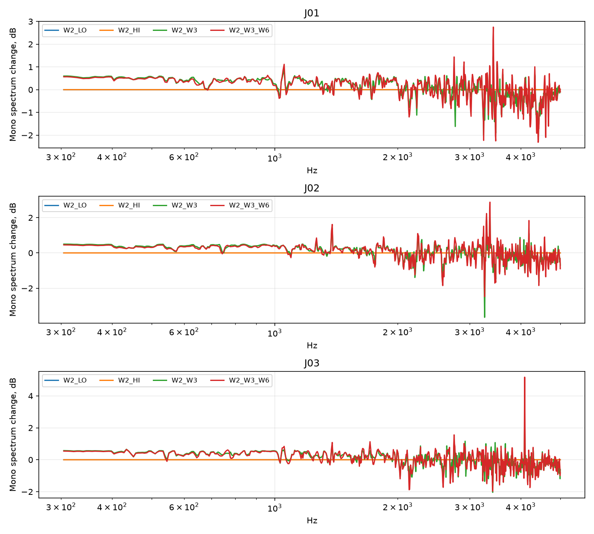

# Качество пространственных алгоритмов — 29 сентября 2026

## Вывод

**Оснований считать текущую реализацию законченной системой премиального звучания нет.**
W2 — наиболее аккуратная из проверенных основ. W3/W6 требуют доработки сохранности
тембра и центра на переходах; XTC — исправления временного выравнивания и проверки
устойчивости к геометрии. Положительный результат 13 существующих тестов этого не опровергает:
расширенные пробы обнаружили ситуации, которых в них нет.

«Уровень Sonos» здесь — цель по качеству пользовательского звучания. Система Sonos
не измерялась, её внутренние алгоритмы не исследовались; равенство, превосходство или
отставание по слышимому качеству этим исследованием не установлены.
Организация файлов и нарезка не являются предметом оценки.

## Что фактически проверено

- Существующий рендер DSP 0.1.2, настройки сохранены в ключе. Анализатор 0.1.3;
  обработка звука между этими версиями не менялась.
- Три фрагмента Marcin по 40 секунд: In Motion, Pt. 1 (219,5 с),
  Riders On The Storm (185 с), Vashkar (175 с); семь вариантов каждого.
- 60 прогонов: четыре алгоритма × пять корреляций независимых розовых шумов
  (0; 0,25; 0,5; 0,75; 1) × три seed, по 12 секунд.
- 24 прогона с углами W3 0/15/30/45° на первых 12 секундах каждого фрагмента.
- Восемь проб атак: центральный и независимый стереошумовой пакет по 10 мс,
  окружённый тишиной. Проверка тишины для всех семи вариантов.
- 18 симуляций синхронизации по 60 секунд: σ 0/20/100 мкс, дрейф ±20 ppm,
  три seed, разные АЧХ каналов и комнатные отклики, шум.
- Шесть фильтров XTC: две расчётные дистанции × три регуляризации;
  импульсная проверка и модельное воспроизведение на дистанциях 0,4 и 0,6 м.

Синтетические сигналы — диагностические воздействия, а не демонстрация звучания.
Слуховые оценки не создавались. [Полные числа и параметры](evaluation.json),
[таблица измерений музыкального материала](evaluation.md).

## 1. W2: сохранность моно хорошая, польза для сцены пока не доказана

Моно-сумма сохраняется практически точно на всех проверенных сигналах.
Это следует и из конструкции `L=M+S'`, `R=M−S'`: изменение Side не меняет Mid.
Центральный короткий пакет тоже остаётся неизменным.

На музыке среднее отношение Side/Mid изменилось с −6,71 дБ у REF до −6,57 дБ
у W2_LO и −6,35 дБ у W2_HI. Это небольшое изменение общей энергии Side;
его нельзя напрямую переводить в воспринимаемую ширину или считать доказательством
слабого эффекта в отдельных частотных полосах. Для ширины нужен слуховой эксперимент.

Когерентность и ILD — эвристики, а не разделение инструментов и реверберации.
При независимых каналах одинакового спектра маска diffuse достигает около 0,90.
Такой сигнал может описывать и рассеянную составляющую, и два жёстко разведённых
прямых источника. Алгоритм не различает эти случаи. На одном seed W2_HI меняет
уровни каналов на +0,94/+1,07 дБ. Нельзя обещать сохранение положения каждого
инструмента только на основании теста с разными спектрами L/R.

## 2. W3/W6: спектральные изменения подтверждаются несколькими проверками

| Проверка | W2_LO / W2_HI | W2_W3 | W2_W3_W6 |
|---|---:|---:|---:|
| Музыка, худшая неравномерность моно, дБ пик-пик | ≈0 | 6,00 | 7,14 |
| Музыка, только бины REF выше −40 дБ от максимума мощности в полосе | ≈0 | 5,42 | 7,14 |
| Независимые шумы, диапазон по трём seed | ≈0 | 2,80–2,91 | 5,93–6,62 |
| Корреляция 0,5, диапазон по трём seed | ≈0 | 0,77–1,00 | 1,42–2,01 |

Измерение: Welch, 8192 отсчёта, перекрытие 4096, 300–5000 Гц; сравнение с тем
же входным сигналом. Ориентир ТЗ — 1 дБ пик-пик. При этом обязательный критерий
по сглаженным 1/3-октавным полосам проходит: худшие отклонения формы 0,78 дБ
для W3 и 0,74 дБ для W6 при пределе 2 дБ. Эти два результата совместимы:
сглаживание скрывает узкие изменения.

Это спектральная разница выходной и входной музыки, а не измеренная стационарная
АЧХ нелинейной адаптивной системы. Пики в слабых спектральных бинах требуют
осторожной интерпретации; дополнительный порог мощности показывает, что проблема
не сводится к почти нулевым бинам. Слышимость по этим числам не установлена.

**Причина по коду:** противоположные фазовые повороты каналов меняют не только
Side. Для поворачиваемой составляющей `M' = cos(θ)·M + j·sin(θ)·S`;
Side попадает в моно-сумму. Устранение отдельной задержки путей само по себе
не обеспечивает сохранения моно-спектра. Уровень diffuse и частотная полка тоже
меняют Mid; W6 дополнительно добавляет задержанные перекрёстные составляющие.

Проверка параметра подтверждает вклад фазового угла: на 12-секундном отрывке
J03 уменьшение θ с 45° до 0° снижает ripple W3 с 9,02 до 1,22 дБ.
Отключения одного угла недостаточно: даже при θ=0 W6 даёт 2,24 дБ.
Эти числа относятся к 12-секундному отрывку и не подменяют результат целых 40 секунд.



## 3. Центр и атаки: стационарного монотеста недостаточно

На непрерывном полностью коррелированном шуме маска равна нулю, центр защищён.
Но на коротком центральном пакете после тишины W3 создаёт Side/Mid **−39,17 дБ**,
W6 — **−39,00 дБ**, хотя во входе Side отсутствует. W2 сохраняет такой пакет точно.
Это измеримое нарушение строгой сохранности моно на переходе; величина слышимого
смещения центра отдельно не измерялась.

Вероятная причина по реализации: в тишине оценка когерентности равна нулю,
а временное сглаживание маски переносит ненулевой diffuse-вес на границу атаки.
Нужны защита по энергии и повторная проверка инвариантов после сглаживания маски.

Перед независимым стереопакетом W3 создаёт пик **−27,45 дБ** относительно пика
выхода; энергия до начала пакета — **0,0257%** общей энергии. W2_LO даёт −45,07 дБ,
W2_HI −37,90 дБ. Это предзвон в офлайн-обработке, не доказательство его слышимости.
Тест совпадения положения главного пика его не обнаруживает.

## 4. XTC: ошибка выравнивания и зависимость от положения

Для всех шести настроек после заявленной компенсации остаётся **1440 отсчётов,
то есть 30 мс**, относительно входного импульса. Метаданные при этом сообщают
`delay_compensated=True`. В `design_xtc_filters` фазовая задержка добавляется
до IFFT, затем выборка индексов с дополнительным сдвигом переносит отклик ещё раз;
`apply_xtc` убирает только один сдвиг. Сравнение с REF получается временно смещённым.

В той же упрощённой модели, на которой рассчитан фильтр, медианное улучшение
отношения перекрёстного сигнала к прямому составляет около 27–72 дБ. Это не
прогноз для телефона: совпадение модели проектирования и проверки завышает
практическую уверенность. При несовпадении дистанций 0,4/0,6 м результат уже
около 4,6–6,4 дБ по медиане, на отдельных частотах почти отсутствует.

Проверены частоты 600–5500 Гц с шагом около 23,4 Гц. Боковые смещения головы,
реальные динамики, отражения и индивидуальная геометрия головы не измерялись.
Для устойчивой сцены нужны измеренные акустические передаточные функции и
проверка области прослушивания, а не настройка единственной идеальной точки.

## 5. Синхронизация и динамическая обработка

Анализатор записи прошёл все 18 модельных случаев: максимальная ошибка σ
**1,875 мкс**, ошибка дрейфа **0,000350 ppm**, при допусках 5 мкс / 1 ppm.
Это проверяет измеритель; устойчивость воспроизведения реальной пары телефонов
по этим данным неизвестна.

Уровни музыкальных вариантов совпадают до показанных 0,001 LUFS. Найден небольшой
выход за заданный потолок: ANCHOR_OVER достигает **−0,987 dBTP** при цели −1 dBTP.
Причина в последующем усилении после лимитера и разрешённом в коде допуске 0,02 дБ.
Это второстепенное замечание к запасу по пику; такой масштаб превышения сам по себе
не доказывает слышимого искажения. Основные кандидаты потолок на этих треках соблюдают.

## Что необходимо для целевого качества

1. **Сохранность основы.** Зафиксировать инварианты центра и моно на тишине,
   атаках, смене сцены и смешанном материале. Рассмотреть обработку рассеянного
   Side с сохранением Mid вместо независимого поворота L/R. Это направление
   переработки, его звучание ещё предстоит оценить.
2. **Стабильная адаптация.** Добавить защиту по энергии, проверить движение маски
   и модуляционные артефакты на вокале/солирующем инструменте с фоном, барабанах,
   реверберационных хвостах и жёстком панорамировании. Три музыкальных фрагмента
   недостаточны для вывода о жанровой устойчивости.
3. **Акустическая устойчивость.** После исправления XTC измерить реальные L/R→уши
   или микрофонные позиции; проверить центр и ±10 см, расстояния 0,4/0,6 м,
   несколько помещений и уровней. Оценивать разброс результата по позициям.
4. **Реальная реализация.** Текущий код использует двунаправленные фильтры,
   центрированные окна, сглаживание с будущими кадрами и статистику всего файла.
   Для потока нужна отдельная реализация с состоянием и явным бюджетом задержки,
   проверенная на границах блоков. Нельзя предполагать тождественное звучание
   после простой замены фильтров на каузальные.
5. **Слышимая польза.** После устранения найденных проблем провести слепое
   сравнение с выравниванием громкости: ширина/глубина вместе с центром, тембром,
   атаками и естественностью. Сравнение с конкретной системой Sonos потребует
   самой системы, одинакового материала и зафиксированных условий прослушивания.

Рекомендуемый порядок: переходы маски и сохранение Mid → W3/W6 → выравнивание
и устойчивость XTC → реальные акустические измерения → слепое сравнение.
По этой проверке выбрана техническая основа для дальнейшей работы, но победитель
по звучанию не назначен.

## Воспроизведение

Из каталога `tools/spatial-proto`:

```bash
.venv/bin/python -m unittest discover -s tests -v
.venv/bin/python evaluate_algorithms.py \
  out/ui/7adfaed0aade45499700294d1cd10f1c \
  --output out/evaluation-marcin-20260929
```

Исходные WAV лежат в локальном рендере и в Git не включены. Их SHA-256,
параметры DSP и seed записаны в `evaluation.json`. Значение −300 дБ в данных
обозначает численный пол функции логарифма, в частности при точно нулевом Side.
