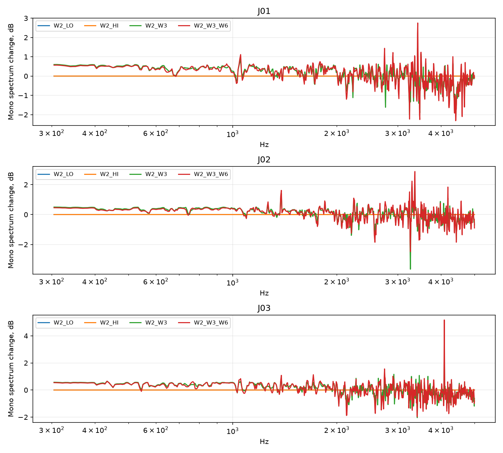

# Диагностика алгоритмов

Анализатор 0.1.3; исходный рендер 0.1.2.
Это объективные измерения и явно синтетические пробы; слуховых оценок здесь нет.

| Вариант | LUFS, min…max | Пик 4×, max dBTP | Моно ripple, max dB | S/M, среднее dB |
|---|---:|---:|---:|---:|
| REF | -18.000…-18.000 | -1.865 | 0.000 | -6.71 |
| ANCHOR_MONO | -18.000…-18.000 | -1.684 | 0.000 | -300.00 |
| ANCHOR_OVER | -18.000…-18.000 | -0.987 | 0.240 | 1.28 |
| W2_LO | -18.000…-18.000 | -1.887 | 0.000 | -6.57 |
| W2_HI | -18.000…-18.000 | -1.923 | 0.000 | -6.35 |
| W2_W3 | -18.000…-18.000 | -1.846 | 6.002 | -6.60 |
| W2_W3_W6 | -18.000…-18.000 | -1.815 | 7.136 | -6.59 |

Все пробы, параметры и SHA-256 WAV: `evaluation.json`.
